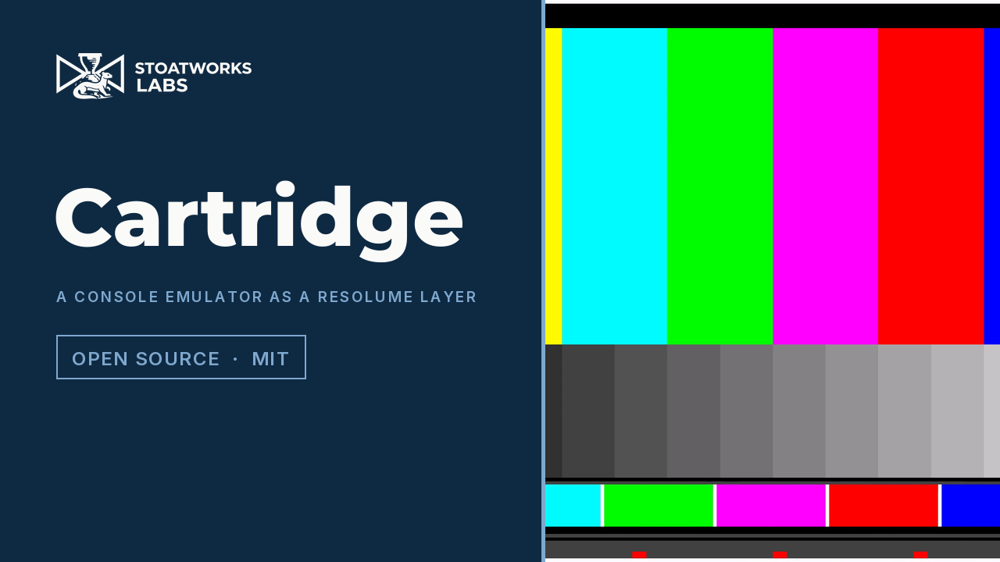

# cartridge

> **AI-assisted project.** This codebase was created with [Claude](https://claude.com/claude-code)
> (Anthropic), directed and reviewed by a human author. The macOS build has been checked end to
> end, from a synthetic core up through real third-party cores and mGBA running a real GBA
> cartridge image, to Resolume Arena 7.27.1 with cores swapped live on a running layer. **The Windows
> build is compiled in CI and ships as of v0.1.2, but has never been loaded into a Windows
> host**, and the Linux branch has never been built. Whether a controller MIDI-maps onto the
> pad is **unconfirmed**, so check it in your own rig before a show depends on it. The details
> are in the Status section further down.

**A console emulator as a live Resolume source.**

`cartridge` is a [libretro](https://www.libretro.com/) frontend that runs inside Resolume
Arena/Avenue as an FFGL generator. Point it at a core and a game and the console becomes a
layer: composite it, key it, run it through other effects, and MIDI-map the joypad onto
whatever controller is already on the desk.

I built it as a companion to [old-cathode](https://github.com/stoatworks-labs/old-cathode).
Putting a 240p Mega Drive frame through a real composite encoder, with dot crawl and
cross-colour that come from the encoding rather than being painted on, is what this was made
for.

> **No emulator core, BIOS image or game is included, and none ever will be.**
> You supply your own, the same as you would with RetroArch.
> **[docs/CORES.md](docs/CORES.md) is how to get them**: where to download, which core for
> which console, and the two macOS traps (architecture matching and Gatekeeper quarantine)
> that will otherwise cost you an afternoon.


<sub>A real third-party libretro core through the plugin's own frame path: 2048 from the libretro buildbot, played by a scripted joypad in the offline harness (`cartest --script docs/hero-cues.txt`) to a score of 2992, with the last frame written out and scaled ×3 with no filtering. It isn't a Resolume screen capture, and it isn't an emulated console either, because the emulator path needs a ROM and nobody ships one here.</sub>

[](https://www.youtube.com/watch?v=K3U4ro6kL80)

*[Watch it](https://www.youtube.com/watch?v=K3U4ro6kL80) (69 seconds): a GBA test card as a layer, four cores swapped on the running layer (GBA, NES, Game Boy, Atari 2600), the joypad parameters on a controller tester, 2048 played by a cue sheet, Speed and Run, Scaling, Pixel Aspect and Smoothing, and the out-of-process helper killed while the layer holds its last frame. An FFGL source doesn't have a window to film, so the footage comes from this repo's own harness (`cargl --pipe`, driven by a cue sheet). The ROMs are my own MIT test cards from [av-test-roms](https://github.com/stoatworks-labs/av-test-roms), and no commercial game or BIOS appears.*

---

## Two builds, one frontend

The same emulator frontend ships twice, and the only difference is which process the core
runs in. Which one you want depends on what you'd like to happen when a core crashes.

|                    | **In process** (the plugin)     | **Out of process** (the helper)      |
| ------------------ | ------------------------------- | ------------------------------------ |
| Latency            | Same frame it was produced      | One composition frame later          |
| A core crashes     | **Resolume goes down with it**  | The helper dies, the show continues  |
| Two of one core    | Needs a private-copy workaround | Free — separate processes            |
| Set up             | Drop the plugin in, pick a file | Run a second program first           |

Rehearsal and studio work: in process. Anything with an audience: the helper.

---

## Building

```bash
git clone --recursive https://github.com/stoatworks-labs/cartridge
cd cartridge
cmake -B build -DCMAKE_BUILD_TYPE=Release
cmake --build build
cmake --install build      # drops the bundle into Resolume's plugin folder
```

## Using it

**In process**: add `SW Cartridge` as a source, set **Core** to a libretro core
(`.dylib` / `.dll`) and **Content** to a game. That's it.

No game to hand? `python3 tools/testrom/build.py` builds a 1 KB GBA test card (animated
bars, crosshatch, a sweeping edge and a checkerboard), so you can prove the path works
without having to get hold of anything. It ships as source, not as a ROM.

If the layer stays black, the answer's nearly always in `~/Library/Logs/cartridge/`. A core
built for the wrong architecture and a core still carrying a quarantine flag both fail
silently otherwise, and the log tells you which it is and how to fix it.

**Out of process**: start the helper, then point the plugin at it:

```bash
./build/cartridge-helper --core /path/to/mgba_libretro.dylib --content game.gba
```

Set the plugin's **Source** to `Helper` and leave **Channel** at `default`.

## Parameters

**Source**, **Core**, **Content**, **Channel**, **Run**, **Reset**, **Speed**
(¼× to 4×, centred on the console's own rate), **Scaling** (Fit / Fill / Stretch
/ Integer), **Pixel Aspect** and **Smoothing**, plus twelve pad buttons in a
**Controller** group.

The buttons are ordinary boolean parameters, which means Resolume should MIDI-map them,
keyboard-map them and automate them off the timeline without any help from me. A hardware
controller becomes a joypad, and you can keyframe a game as a visual. Nobody's put a real
controller on them yet, though, so that's unconfirmed (see Status).

**Integer** scaling and **Smoothing** off is the combination you want for pixel art.
**Pixel Aspect** honours the core's declared display aspect: 320×224 on a Mega Drive is a
4:3 picture, and showing it 1:1 makes it visibly too tall.

## What it does not do

- **Hardware-rendered cores are refused.** Dolphin, Flycast and friends need a GL context
  and an FBO on the emulator thread, and giving them a half-kept promise makes them render
  into Resolume's own framebuffer. It's software cores only: NES, SNES, Mega Drive, Master
  System, Game Boy, GBA, PC Engine.
- **There's no audio.** FFGL doesn't give a plugin any way to hand audio to the host, so
  the samples are decoded and dropped. Sound sent out of the plugin's own audio device
  wouldn't be on Resolume's clock or in its mixer, and for a show that's worse than silence.
- **No core options and no save states** yet.

## Licensing

`cartridge` is MIT. **Emulator cores are not**, and that's why none are bundled:

- **mGBA** is MPL-2.0, which is permissive.
- **Genesis Plus GX** is under a **non-commercial** licence.
- Several cores in the Snes9x lineage carry custom non-commercial terms.
- **Dolphin** and **VBA-M** are GPL.

Cores are `dlopen`ed at runtime and never redistributed, so their terms are between you and
their authors, which is the same arrangement RetroArch uses. Supplying your own game images
is your responsibility too.

<!-- downloads:start -->

## Download

**[v0.1.3](https://github.com/stoatworks-labs/cartridge/releases/tag/v0.1.3)** — prebuilt for macOS and Windows. Pick your platform:

<details>
<summary><b>macOS</b> — Universal (Apple Silicon + Intel)</summary>

| Build | Download | Size |
| --- | --- | --- |
| Universal (Apple Silicon + Intel) · .dmg disk image | [`cartridge-0.1.3-macos-universal.dmg`](https://github.com/stoatworks-labs/cartridge/releases/download/v0.1.3/cartridge-0.1.3-macos-universal.dmg) | 551 KB |
| Universal (Apple Silicon + Intel) · .zip archive | [`cartridge-0.1.3-macos-universal.zip`](https://github.com/stoatworks-labs/cartridge/releases/download/v0.1.3/cartridge-0.1.3-macos-universal.zip) | 271 KB |

</details>

<details>
<summary><b>Windows</b> — x64</summary>

| Build | Download | Size |
| --- | --- | --- |
| x64 · .zip archive | [`cartridge-0.1.3-windows-x86_64.zip`](https://github.com/stoatworks-labs/cartridge/releases/download/v0.1.3/cartridge-0.1.3-windows-x86_64.zip) | 173 KB |

</details>

All builds, checksums and release notes: [github.com/stoatworks-labs/cartridge/releases](https://github.com/stoatworks-labs/cartridge/releases).

macOS builds are signed and notarised and open normally. The Windows builds are unsigned, so SmartScreen warns once.

<!-- downloads:end -->

## Status

**v0.1.3** (2026-10-06) lists the plugin as *SW Cartridge* in the host's browser, as
every Stoatworks plugin now is, and drops zlib from the Windows build's dependencies (only the
Unix-only test harness used it). Nothing else changed.

**v0.1.2, released for macOS and Windows** (2026-09-05): the first release with a Windows x64
build, a disk image for macOS alongside the zip, and the GET_VARIABLE fix (777dd40) that the
v0.1.1 binary predated. It's checked end to end against a synthetic libretro core built into
the repo (`tools/verify.sh`: CPU host, a real GL context at two aspects, a real second
process, and the helper killed with `SIGKILL` under a running consumer).

**It's since been run against real third-party cores.** `2048` and `gong` from the libretro
buildbot both load, negotiate `SET_SUPPORT_NO_GAME`, and produce frames through the same path
the plugin uses. A scripted joypad (`--script`) played 2048 to a score of 1216. That
exercises input, the pixel format, the padded pitch and the triple buffer against code this
project didn't write.

**A real console emulator has been run too.** mGBA loads a GBA cartridge image supplied
locally and runs it at the console's own 59.7275 Hz, with the core's log forwarded
(including its own SRAM save-type detection) and 1800 consecutive frames rendered without a
drop. That exercises the emulator path proper: a real ROM, a real save type, and a core an
order of magnitude bigger than the ones above. No ROM is included in this repo or
distributed with it, and none ever will be.

**And it's run inside Resolume.** In Arena 7.27.1 on macOS it was added to a layer as a
source, ran `InitGL` on the host's own GL 4.1 Metal context, and had three cores loaded and
swapped live on a running layer: 2048, the repo's test core, and mGBA. The parameter groups
land in Arena's inspector as declared: Source as an In Process / Helper pair, Core and
Content as file pickers that open in `~/Documents/Cartridge`, Scaling as Fit / Fill /
Stretch / Integer, and the twelve pad buttons in their own Controller group. Picking mGBA
with no ROM selected put `content load failed: core mGBA requires content` in the log rather
than leaving a silent black layer, which is what that diagnostic is there for.

One thing's still unconfirmed, and it needs hardware rather than a session:

- **Whether a controller actually MIDI-maps onto the pad.** The buttons are ordinary boolean
  parameters, so Resolume should map them like any other, but nobody's put a real controller
  on them yet. Check it in your own rig before a show depends on it.

The macOS build is universal (Apple Silicon and Intel), Developer ID-signed and notarised, so
it opens without a Gatekeeper step. The Windows build is compiled in CI and ships as a zip,
but **nobody has loaded it into a Windows host**. The Linux branch has never been built, and
there's no binary published for it.

<!-- attributions:start -->
This project is built on other people's work — see [ATTRIBUTIONS.md](ATTRIBUTIONS.md).
<!-- attributions:end -->
