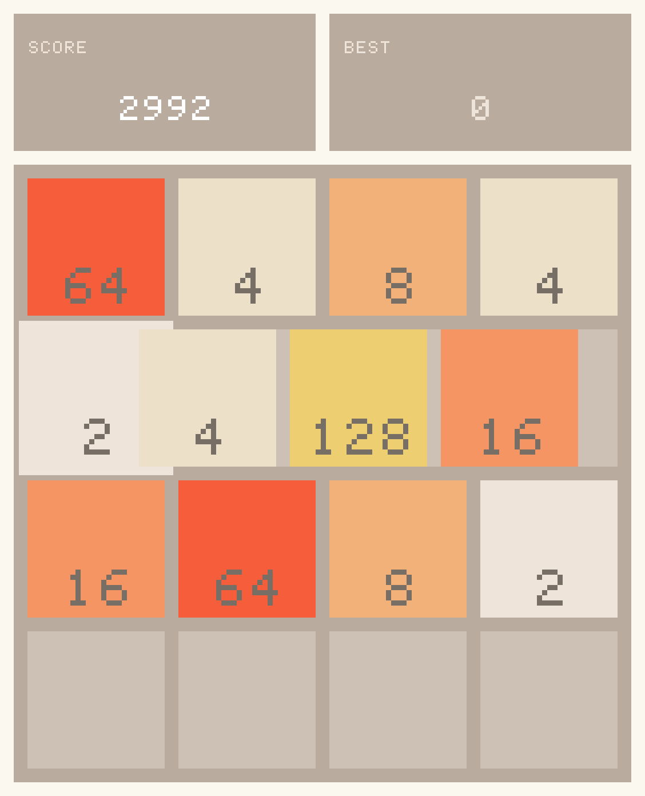

# cartridge user guide

cartridge is a console emulator as a live Resolume source. It's a
[libretro](https://www.libretro.com/) frontend that runs inside Arena or Avenue as an FFGL
generator: point it at a core and a game and the console becomes a layer you can composite, key,
run through other effects, and play by MIDI-mapping the joypad onto whatever controller is
already on the desk.



*A real third-party libretro core through the plugin's own frame path: 2048 from the libretro buildbot, played by a scripted joypad in the offline harness to a score of 2992, with the last frame written out and scaled ×3 with no filtering. It isn't a Resolume screen capture, and it isn't an emulated console.*

I built it as a companion to [old-cathode](https://github.com/stoatworks-labs/old-cathode).
Putting a 240p Mega Drive frame through a real composite encoder, with dot crawl and cross-colour
that come from the encoding rather than being painted on, is what this was made for.

> **No emulator core, BIOS image or game is included, and none ever will be.** You supply your
> own, the same as you would with RetroArch. **[CORES.md](CORES.md) is how to get them**: where to
> download, which core for which console, and the two macOS traps that will otherwise cost you an
> afternoon.

> **Before you rely on this:** the macOS build is verified end to end against a synthetic
> libretro core, against real third-party cores from the buildbot (2048 was played to a score of
> 1216 by a scripted joypad, which exercises input, pixel format, padded pitch and the triple
> buffer against code this project didn't write), against mGBA running a real GBA cartridge image
> for 1800 consecutive frames, and **inside Resolume Arena 7.27.1 with three cores swapped live on
> a running layer**.
>
> One thing's still unconfirmed, and it needs hardware rather than a session: **whether a
> controller actually MIDI-maps onto the pad**. The buttons are ordinary boolean parameters, so
> Resolume should map them like any other, but nobody has put a real controller on them. The
> **Windows and Linux branches have never been built or tested**, and no binary is published for
> either.
>
> This codebase was created with AI assistance, directed and reviewed by a human author.

---

## Choose a build before you choose a core

The same frontend ships twice, and the only difference is **which process the core runs in**.
Which one you want depends entirely on what you'd like to happen when a core crashes.

| | **In process** (the plugin) | **Out of process** (the helper) |
| --- | --- | --- |
| Latency | Same frame it was produced | One composition frame later |
| A core crashes | **Resolume goes down with it** | The helper dies, the show continues |
| Two of one core | Needs a private-copy workaround | Free — separate processes |
| Setting up | Drop the plugin in, pick a file | Run a second program first |

**Rehearsal and studio work: in process. Anything with an audience: the helper.** One frame of
latency is a cheap insurance premium against a core taking the whole show down mid-set.

---

## Running it

**In process:** add `Cartridge` as a source, set **Core** to a libretro core (`.dylib` / `.dll`)
and **Content** to a game. That's all.

**Out of process:** start the helper first, then point the plugin at it:

```bash
cartridge-helper --core /path/to/mgba_libretro.dylib --content game.gba
```

Set the plugin's **Source** to `Helper` and leave **Channel** at `default`.

**No game to hand?** `python3 tools/testrom/build.py` builds a 1 KB GBA test card (animated bars,
crosshatch, a sweeping edge and a checkerboard) so you can prove the whole path works without
getting hold of anything. It ships as source, not as a ROM.

---

## Making it look right

**Integer scaling with Smoothing off** is the combination you want for pixel art. Anything else
resamples a 240p picture onto a 1080p layer and turns crisp pixels into mush.

**Pixel Aspect** honours the core's declared display aspect. 320×224 on a Mega Drive is a **4:3**
picture, and showing it 1:1 makes it visibly too tall. This is the control that fixes the most
common "why does it look wrong" complaint.

**Speed** runs ¼× to 4×, centred on the console's own rate.

## The joypad

Twelve pad buttons live in a **Controller** group, and they're **ordinary boolean parameters**.
That's the whole trick: Resolume will MIDI-map them, keyboard-map them and automate them off the
timeline with no help from this plugin. A hardware controller becomes a joypad, and a game becomes
something you can keyframe as a visual.

---

## What it deliberately does not do

- **Hardware-rendered cores are refused.** Dolphin, Flycast and friends need a GL context and an
  FBO on the emulator thread, and giving them a half-kept promise makes them render into
  Resolume's own framebuffer. **Software cores only**: NES, SNES, Mega Drive, Master System, Game
  Boy, GBA, PC Engine.
- **There's no audio.** FFGL gives a plugin no way to hand audio to the host, so the samples are
  decoded and dropped. Sound from a device of the plugin's own wouldn't be on Resolume's clock or
  in its mixer, which is worse than silence for a show.
- **No core options and no save states**, yet.

---

## Licensing, and why nothing is bundled

cartridge is MIT. **Emulator cores aren't**, and that's why none ship with it:

- **mGBA** is MPL-2.0, which is permissive.
- **Genesis Plus GX** is under a **non-commercial** licence.
- Several cores in the Snes9x lineage carry custom non-commercial terms.
- **Dolphin** and **VBA-M** are GPL.

Cores are loaded at runtime and never redistributed, so their terms are between you and their
authors, the same arrangement RetroArch uses. Supplying your own game images is your
responsibility too, and it matters commercially: a core under non-commercial terms isn't one to
put in front of a paying audience without reading it.

---

## If the layer stays black

**Check the log first.** `~/Library/Logs/cartridge/`. A core built for the wrong architecture and
a core still carrying a Gatekeeper quarantine flag both fail *silently* otherwise, and the log
names which one it was and how to fix it. [CORES.md](CORES.md) covers both traps in full.

**"content load failed: core X requires content".** The core needs a game and none is selected.
Some cores negotiate `SET_SUPPORT_NO_GAME` and run without one; most don't.

**The picture is too tall.** **Pixel Aspect** is off. See above.

**Everything is blurry.** Scaling isn't **Integer**, or **Smoothing** is on.

**Resolume disappeared.** A core crashed, in process. Move to the helper.
